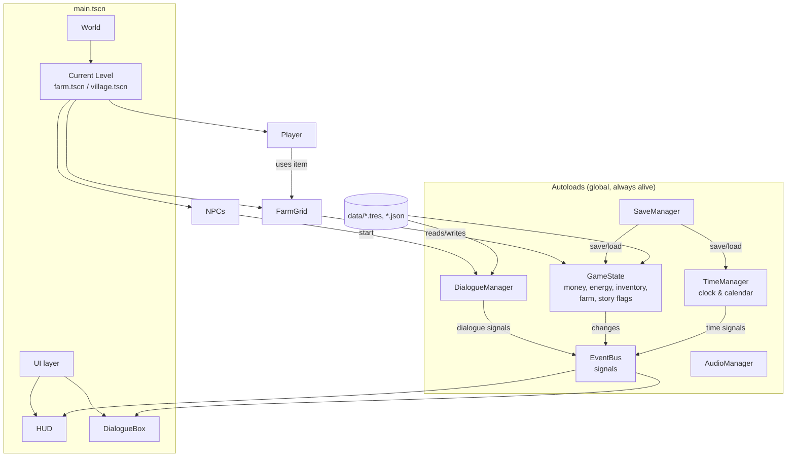

# Architecture

## Goals

1. **Teammates work in parallel.** Art, story and testing should not depend on code changes, and code changes should not break each other.
2. **Data-driven content.** Items, crops and dialogue are data files, so adding content doesn't need a programmer.
3. **Small, decoupled systems.** Systems communicate through signals, not direct references.

## Overview



## Key ideas

### 1. State lives in autoloads, scenes are views

`GameState` holds everything that must survive a level change or be saved: money, energy, inventory, the farm's soil and crops (`FarmState`), and story flags. Level scenes only **display** that state and turn player input into calls on it.

Example: when you leave the farm, the `FarmGrid` node is destroyed but the crops stay in `GameState.farm`. They keep growing overnight even if you are in the village.

### 2. EventBus for cross-system communication

`src/autoload/event_bus.gd` declares the global signals. The HUD doesn't know about the farm; it listens to `EventBus.money_changed`, `EventBus.inventory_changed` and similar signals.

- Emit: `EventBus.crop_harvested.emit(cell, crop_id)`
- Listen: `EventBus.day_started.connect(_on_day_started)`

Use EventBus only between *unrelated* systems. Inside a scene, use normal signals and node references.

### 3. Main scene + swappable levels

`main.tscn` is always loaded. It contains `World` (holds the current level) and the `UI` canvas layer (HUD and dialogue box). A level change is a request: `EventBus.level_change_requested.emit(path, spawn)`. `main.gd` fades out, swaps the level, places the player at the spawn point, and fades back in.

### 4. Content by id

Each item or crop is a `.tres` resource whose **file name is its id** (`data/items/hoe.tres` → `&"hoe"`). `Registry.get_item(&"hoe")` loads it. Saves and dialogue refer to content by id.

## Autoloads

| Name | Responsibility |
|---|---|
| `EventBus` | Global signals only, no logic |
| `TimeManager` | 10-minute ticks, days, seasons, years; `start_next_day()` |
| `GameState` | Money, energy, inventory, farm, story flags; new game setup |
| `DialogueManager` | Loads `data/dialogue/<id>.json`, steps through lines, sets story flags |
| `AudioManager` | `play_music()` with crossfade, `play_sfx()`, bus volumes |
| `SaveManager` | JSON save in `user://savegame.json`; calls `get_save_data()` / `load_save_data()` on saved systems |

Order matters: `EventBus` must stay first because the others use it in `_ready()`.

## Day cycle

```
06:00 day starts ── time ticks every 7 real seconds (+10 min) ── 02:00 pass out
                                                                     │
            Bed.interact() ──► TimeManager.start_next_day() ◄────────┘
                                   │ emits day_started
                                   ▼
                     GameState: restore energy, farm.advance_day(season)
                                   │  (watered crops grow, soil dries,
                                   ▼   out-of-season crops die)
                              SaveManager.save_game()  (when sleeping)
```

## Story flow

The story follows `docs/Game story.docx` and the dialogue spreadsheet (repo-level `docs/`):

1. **New game:** the avatar selection screen (`src/ui/avatar_select/`) pauses the game until the player picks one of the four looks in `data/avatars/`.
2. **Day 1, farm:** the Government Official waits at the farmhouse door and starts `land_requisition_notice` by himself. It sets `main_quest_started` and `buyback_goal_unlocked`, so the HUD shows the days left and the buy-back price (`GameState.DEADLINE_DAYS`, `GameState.BUYBACK_PRICE`). Then he leaves.
3. **Village:** the Village Chief and the Merchant have one-time introductions, then repeat lines.
4. **Day 4, farm:** the Inventor visits and proposes the deal (`inventor_deal_accepted`). Afterwards he is found at his workshop in the village.

Story progress is stored as **story flags** (`GameState.story_flags`), set by dialogue lines and saved with the game. NPCs use flags and the day number (`TimeManager.get_day_number()`) to decide whether they're present and what they say; see [data/README.md](../data/README.md#when-npcs-say-what).

Conversations are `DialogueGraph`s (`src/systems/dialogue/`): lines linked by id, optional choices, and effects (flags, friendship, notifications). `DialogueManager` plays them, and the dialogue box shows lines and choices.

## Maps

| Scene | Design doc | Size | Contents |
|---|---|---|---|
| `src/world/farm/farm.tscn` | Map 01 Starting Farm | 80×65 tiles | Farmhouse (upper right; its door is where you sleep), farming area (`FarmGrid`), pond (lower left), forest along the north and west, path to the eastern exit, farming-tips signpost |
| `src/world/village/village.tscn` | Map 03 Villager Residential Area | 70×55 tiles | Western entrance, central square, chief's house (north), shop (east), inventor's workshop (south-east), blocked road east |

Map 02 (Western Beach) isn't built yet: it needs sand, cliff and pier art.

Each level has: `Ground` (plain grass colour), `GroundTiles` (paths, water) and `Decor` (grass tufts, bushes) TileMapLayers sharing `assets/art/tilesets/world_tileset.tres`, then `FarmGrid` (farm only), `Entities` (y-sorted: player, NPCs, props), `Warps`, `SpawnPoints`, and `Bounds`.

**Props** (`src/world/props/`) are ready-made scenes for trees, houses, fences, solar panels, the scarecrow and the signpost: drag them under `Entities`. Their collision covers only the base, so the player can walk behind them. `tree_maple.tscn` changes with the season.

## How to…

### Add an item
1. In the FileSystem dock, right-click `data/items/` → **New Resource** → `ItemData`.
2. Save as `<id>.tres` and set `id` to the same name.
3. Fill in name, icon, category, price. For tools set `tool_type`; for seeds set `crop_id`.

### Add a crop
1. Create a `CropData` resource in `data/crops/<id>.tres`.
2. Set `days_per_stage`, `harvest_item`, `seasons`, and (once art exists) `stage_textures`. Use one texture per stage plus one for "ready".
3. Create a seed item with `category = SEED` and `crop_id = <id>`.

### Add an NPC
Instance `src/entities/npcs/npc.tscn` under a level's `Entities` node. Set `npc_name`, a `sprite_texture` (a strip of 16×32 idle frames from `assets/art/characters/`), and the dialogue and presence properties described in [data/README.md](../data/README.md#when-npcs-say-what).

### Add a level
1. Duplicate `src/world/village/village.tscn` (it uses `level.gd`) and delete what you don't need.
2. Keep the `Entities/Player`, `SpawnPoints/` and `Bounds` nodes. Set `bounds` to the map size (and move the `Bounds` edges to match).
3. Paint paths and water on `GroundTiles` and decoration on `Decor`.
4. Connect it to another level with a `LevelWarp` (set `target_level` and `target_spawn`), with a matching spawn point on each side. Keep spawn points a few tiles away from warps.

### Add something interactable (sign, chest, shop counter…)
- **Something that only talks:** use `sign.tscn`, or add a `DialogueSpot` (an Area2D with `dialogue_spot.gd`) and set its `dialogue_id`.
- **Anything else:** add an `Area2D` with `interactable.gd` and a `CollisionShape2D`, then connect its `interacted` signal. You can also extend `Interactable` and override `interact()`, as `bed.gd` does.

### Draw something in `_draw()`
Load textures *before* drawing (e.g. in `_ready()` or when the data changes), never inside `_draw()`. A texture loaded for the first time during drawing renders as a white box. `FarmGrid` caches its crops for this reason.

### Save a new system
Give it `get_save_data() -> Dictionary` and `load_save_data(data: Dictionary)`, then add it to `_saved_systems()` in `save_manager.gd`.

## Physics layers

| # | Name | Used by |
|---|---|---|
| 1 | world | walls, map bounds, obstacles |
| 2 | player | Player body (LevelWarps detect it) |
| 3 | npc | NPC bodies |
| 4 | interactable | `Interactable` areas (Player's InteractArea detects them) |

## Display

The base resolution is 640×360, upscaled to the window (1280×720 by default) with the `canvas_items` stretch mode, nearest-neighbour filtering and pixel snapping, which suits pixel art. The tile size is **16×16**.

## Placeholders still in use

| Placeholder | Where | Replace with |
|---|---|---|
| Plain grass colour | `Ground` node in each level | A seamless 16×16 grass tile painted on a TileMapLayer |
| Brown squares for tilled soil | `FarmGrid` | `dry_soil_texture` / `wet_soil_texture` once full-tile soil art exists |
| Signpost made of rectangles | `src/world/props/sign.tscn` | A sign sprite |
| Text in hotbar slots for seeds and carrots | `hud.gd` | `icon` on `carrot_seeds.tres` / `carrot.tres` |
| Plain energy bar | `hud.tscn` | ProgressBar styles in the theme |

See `assets/ASSET_CHECKLIST.md` for the art status.

## Planned next systems

From the story and design documents: shipping bin and nightly sales, shop and selling (Merchant), inventor upgrades and the items in `docs/Future_Land_Item_List.xlsx` (sickle, axe, cultivator, lawn mower, sprinkler, chainsaw), clearing weeds/stones/branches, farmhouse interior, Western Beach with fishing, notice board, the two endings at the deadline, seasonal music and weather. Also: inventory screen, pause and settings menu, main menu with save slots.
